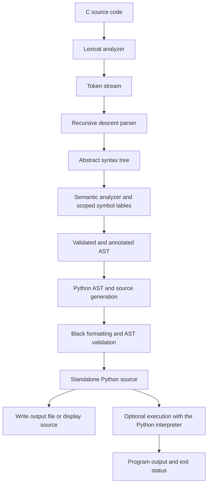
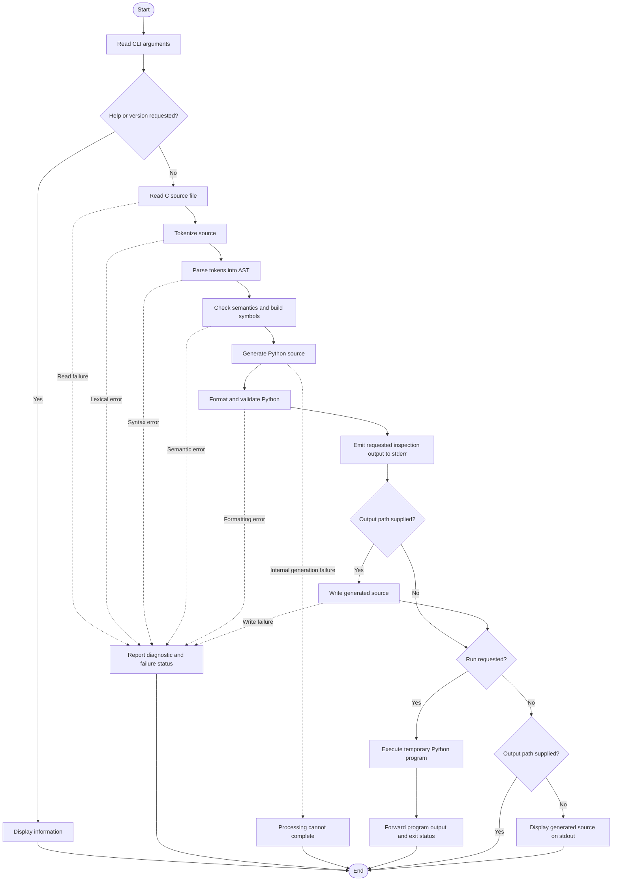
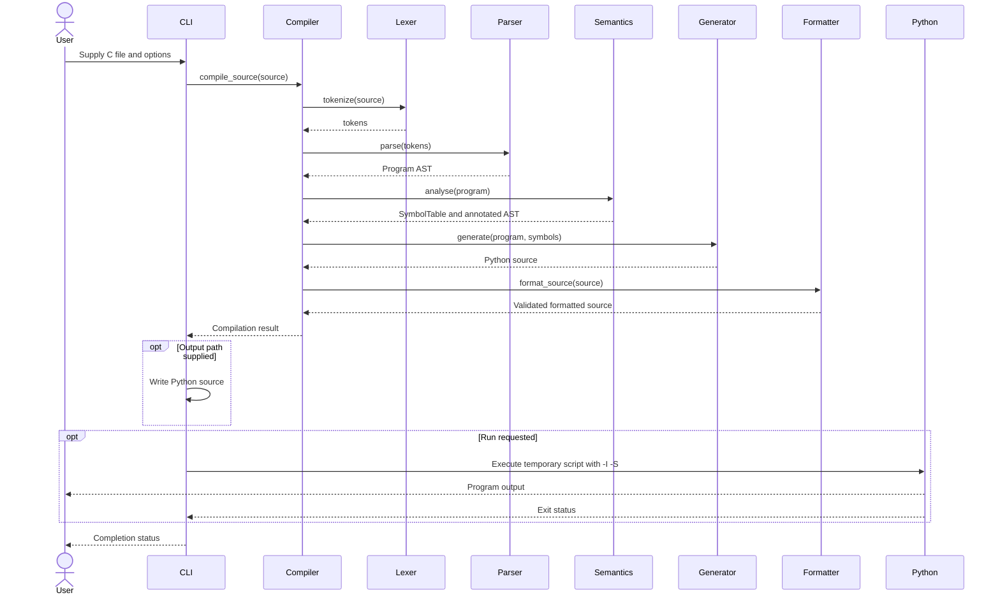
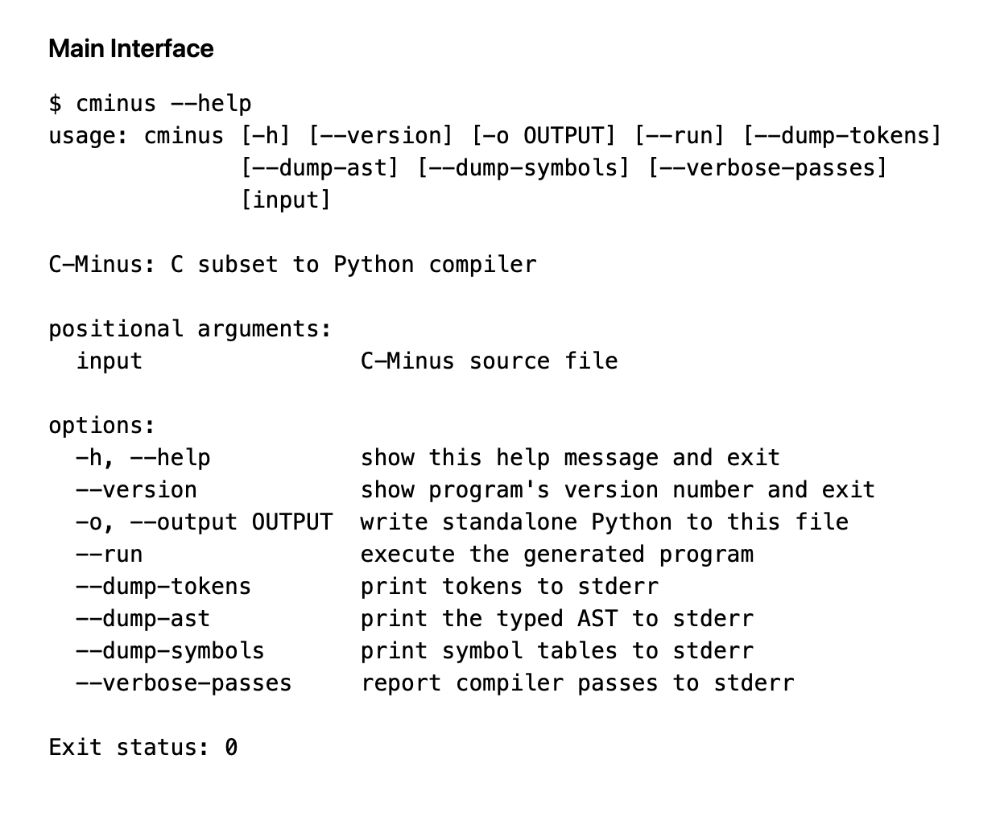
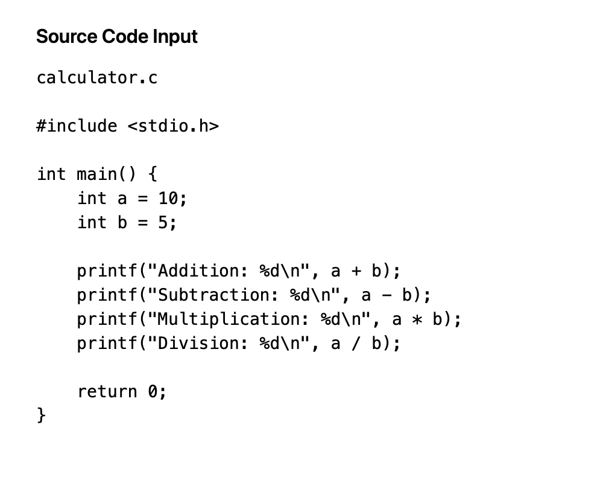
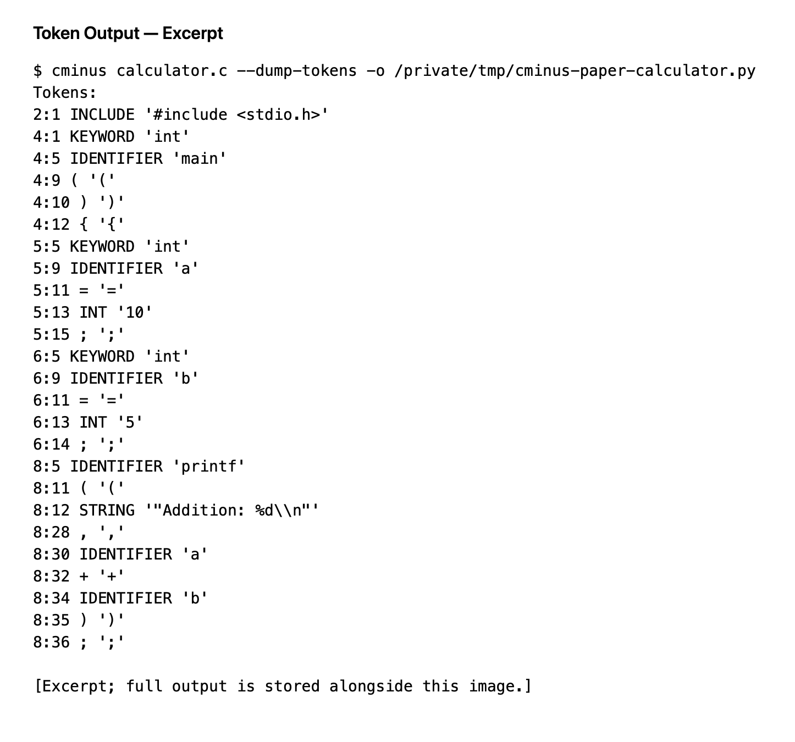
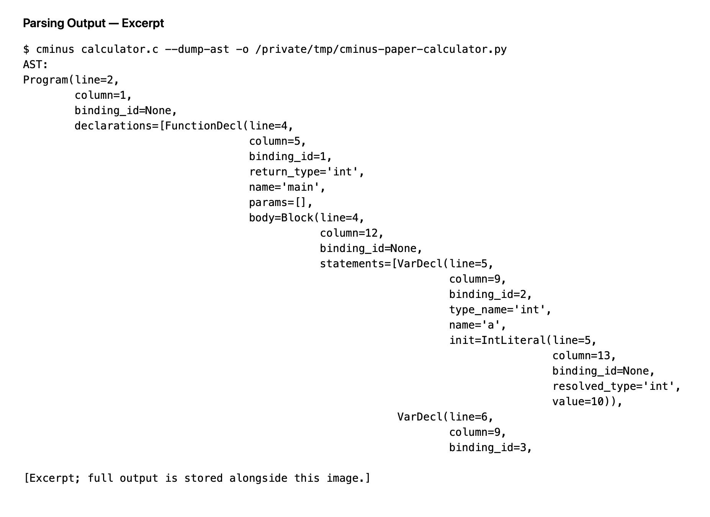
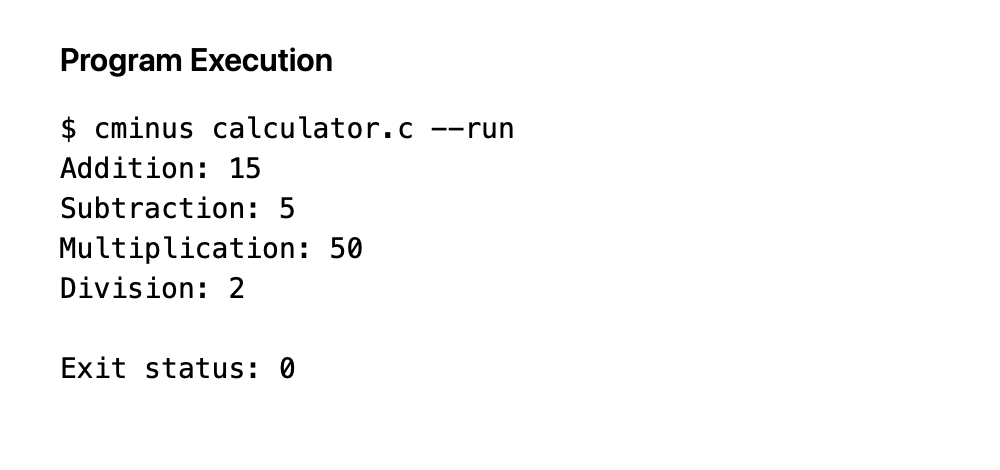
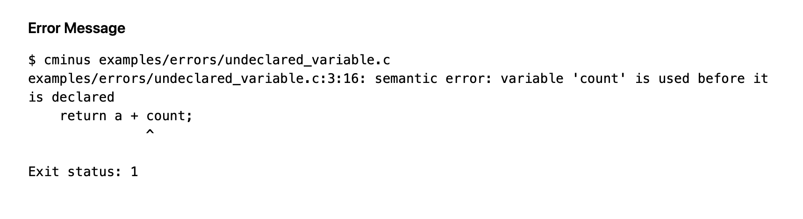

# TECHNOLOGICAL INSTITUTE OF THE PHILIPPINES

938 Aurora Boulevard, Cubao, Quezon City  
COLLEGE OF COMPUTER STUDIES

**CS 200 — Principles of Programming Languages**  
1st Semester, School Year 2026–2027  
Finals Period

**Group No.:** __________  
**Topic:** Mini Compiler (Source to Source)  
**Program / Section:** BSCS / __________  
**Date:** 11 October 2026  
**Instructor:** Ms. Elsa V. Isip-Barcelos  
**Activity Title:** Assignment 5.2 — Final Project Requirements (Part 2)

**Group Members**

- Adora, Adriel Brien D. — BSCS
- Cipriano, Hilarie E. — BSCS
- Malimban, Marie Andrea S. — BSCS
- Narag, Cire Angelo C. — BSCS
- Nera, Stephen Jarcelle D. — BSCS

---

# C-Minus: From C to Python

Technological Institute of the Philippines, Quezon City  
College of Computer Studies

In partial fulfillment of the requirements for  
**CS 200 — Principles of Programming Languages**

**Submitted by**

Adora, Adriel Brien D.  
Cipriano, Hilarie E.  
Malimban, Marie Andrea S.  
Narag, Cire Angelo C.  
Nera, Stephen Jarcelle D.

**Submitted to**  
Ms. Elsa V. Isip-Barcelos

October 2026

---

# CHAPTER 3 — SYSTEM DESIGN

This chapter describes the design of C-Minus 0.2.0, a source-to-source compiler that translates a defined subset of C into standalone Python 3.10 or newer. It explains the development methodology, compiler architecture, implementation language, accepted source grammar, symbol tables, and error handling. The supported source language includes limited pointers to integer and boolean variables; it does not implement the full ISO C language.

## 3.1 Development Methodology

C-Minus was developed using evolutionary prototyping. An initial working compiler pipeline established that simple C programs could be translated into executable Python. The prototype was then refined as additional language constructs and translation requirements were introduced.

Development proceeded through the following activities:

1. **Requirements formulation.** The supported C subset, Python target, compiler phases, diagnostic requirements, and exclusions were defined. The scope was later extended to include one-level pointers to integer and boolean variables.
2. **Initial prototype development.** Lexical analysis, recursive-descent parsing, semantic checking, and Python generation were connected into a working pipeline.
3. **Prototype evaluation.** Sample programs were translated and executed to identify missing functionality, incorrect expression grouping, and differences between C and Python behavior.
4. **Feature refinement.** The implementation was extended with scoped variables, functions and prototypes, global variables, loops, loop-control statements, richer output formatting, and the agreed pointer operations.
5. **Behavioral verification.** The original C programs were compiled with GCC, and their output and exit status were compared with the generated Python programs. Unit and regression tests checked individual compiler components and complete translations.
6. **Packaging and documentation.** Diagnostics and generated-code readability were improved. The compiler was packaged as an installable command-line application, and its grammar, examples, and verification results were documented.

This methodology supported repeated implementation, evaluation, and refinement. The final result is a working compiler for the documented subset, with explicit boundaries and regression tests.

## 3.2 Overall System Architecture

C-Minus processes source code through five compiler passes: lexical analysis, syntax analysis, semantic analysis, Python code generation, and Python formatting. Execution is an optional action performed after successful compilation.



*Figure 3.1. Overall compiler architecture.*

The lexer recognizes tokens and records their positions. The parser builds the shared C-Minus AST. Semantic analysis resolves declarations, annotates expression types, and returns a symbol table. The generator constructs a Python AST and converts it into Python source. Black formats the source at a target line length of 79 characters, and the formatter checks that its AST remains unchanged and that the result compiles.

The compiler writes or displays the generated source only after successful compilation. With `--run`, it writes the generated program to a temporary file and invokes Python with `-I -S`. The program can also be saved and executed independently without an installed C-Minus package. pycodestyle is used in testing; it is not a compiler pass.

## 3.3 Implementation Language Specifications

Python is the host language used to implement C-Minus and the target language of its generated programs. The package requires Python 3.10 or newer. The implementation uses standard-library modules and custom classes to represent tokens, syntax trees, symbols, and compiler results.

### Keywords

| Python keywords | Role in the implementation |
|---|---|
| `def`, `return` | Define processing functions and return results |
| `class` | Define parser, analyzer, generator, and data-model classes |
| `if`, `elif`, `else` | Select token rules, parsing branches, and validation procedures |
| `for`, `while`, `break`, `continue` | Scan text and traverse collections and syntax structures |
| `import`, `from` | Access project modules and libraries |
| `try`, `except`, `finally`, `raise` | Report errors and restore processing state |
| `with` | Manage files and temporary execution resources |

The implementation dispatches by conditions and visitor methods. It does not require Python structural pattern matching.

### Operators

| Category | Examples | Application |
|---|---|---|
| Arithmetic | `+`, `-`, `*`, `//`, `%` | Update positions, evaluate integer expressions, and implement C arithmetic helpers |
| Comparison | `==`, `!=`, `<`, `<=`, `>`, `>=` | Compare tokens, counts, and values |
| Logical | `and`, `or`, `not` | Combine validation conditions |
| Assignment | `=`, `+=` | Update compiler state and collections |
| Membership | `in`, `not in` | Check keyword sets, dictionaries, and supported operators |
| Identity | `is`, `is not` | Check optional values and object identity |

### Data Types and Data Models

| Python type | Use in C-Minus |
|---|---|
| `str` | Source text, lexemes, type names, identifiers, and generated code |
| `int` | Source positions, integer values, binding IDs, and loop-depth counters |
| `bool` | Compiler-state flags and normalized boolean values |
| `list` | Tokens, AST statements, parameters, and scope collections |
| `tuple` | Format specifications and operator-precedence groups |
| `dict` | Symbol mappings and binding lookup tables |
| `set` | Keywords, supported types, visible declarations, and required helpers |
| `bytes`, `bytearray` | Exact output handling and behavioral comparisons |
| `None` | Missing optional AST values and generated null-pointer values |

The `@dataclass` decorator defines structured records such as `Token`, AST nodes, `Symbol`, `Scope`, and `Compilation`; it is not itself a data type. The semantic analyzer represents a void type with the string `"void"`, while `None` represents an absent return expression or another optional value.

### Identifiers and Code Conventions

Python identifiers are case-sensitive, cannot begin with a digit, and cannot use reserved Python keywords. Examples from the implementation include `compile_source()`, `tokenize()`, `parse()`, `analyse()`, and `generate()`. Class names include `Parser`, `SemanticAnalyser`, `SymbolTable`, `CodeGenerator`, and `Node`. Constants include `KEYWORDS`, `NUMERIC_TYPES`, `POINTER_TYPES`, and `TYPE_INT`.

### Literals and Comments

Python integer, string, boolean, and collection literals represent compiler values and configuration. F-strings construct diagnostic and inspection text. Single-line comments begin with `#`, and docstrings explain module, class, and function behavior. Indentation determines Python block structure.

## 3.4 Lexical Rules

The source-language lexer scans C-Minus input from left to right. Each token stores `type`, `lexeme`, `line`, and `column`. Line and column numbers are one-based. CRLF and CR line endings are normalized to newlines.

Whitespace, line comments beginning with `//`, and block comments enclosed by `/*` and `*/` are discarded. Position tracking continues through ignored text.

| Token type | Rule | Examples |
|---|---|---|
| `INCLUDE` | A whitelisted virtual include on its own source line | `#include <stdio.h>`, `#include <stdbool.h>` |
| `KEYWORD` | A reserved source word | `int`, `while`, `return` |
| `BOOL` | Exactly `true` or `false` | `true`, `false` |
| `IDENTIFIER` | An ASCII letter or `_`, followed by ASCII letters, digits, or `_` | `count`, `_total2` |
| `INT` | `0`, or a nonzero decimal digit followed by decimal digits | `0`, `42`, `1000` |
| `STRING` | A double-quoted string without a physical newline, using supported escapes | `"Sum: %d\n"` |
| Operator or punctuation | The token type is the operator or punctuation itself | `+`, `==`, `{`, `;` |
| `EOF` | An explicit token added after the input | Empty lexeme |

Supported keywords are `int`, `bool`, `void`, `if`, `else`, `while`, `do`, `for`, `return`, `break`, and `continue`. Reserved but unsupported words include `float`, `double`, `string`, `char`, `struct`, `union`, `enum`, `typedef`, `short`, `long`, `unsigned`, `signed`, `switch`, `case`, `goto`, `static`, `const`, and `extern`. They are recognized as keywords and rejected where the supported grammar does not allow them.

Supported operators and punctuation are:

- Arithmetic: `+`, `-`, `*`, `/`, `%`.
- Relational and equality: `<`, `>`, `<=`, `>=`, `==`, `!=`.
- Logical: `&&`, `||`, `!`.
- Assignment: `=`.
- Address-of and dereference: `&` and `*`.
- Punctuation: `(`, `)`, `{`, `}`, `;`, `,`.

Two-character operators are recognized before single-character operators. Supported string escapes are `\n`, `\r`, `\t`, `\a`, `\b`, `\f`, `\v`, `\0`, `\\`, `\"`, `\'`, and `\?`.

Virtual includes appear before top-level declarations. Whitespace around `#`, `include`, and the header is accepted. The directive must occupy its own line, apart from permitted whitespace and a trailing line comment or same-line block comment. The compiler does not read headers or expand macros.

Lexical errors include unterminated comments and strings, invalid escapes, unsupported characters, unsupported headers, malformed decimal literals, and excluded operators such as `++`, `--`, `+=`, `-=`, `*=`, `/=`, `%=`, `<<`, `>>`, and `->`. A single `&` is supported as address-of; bitwise AND is not part of the expression grammar.

## 3.5 Grammar in EBNF

The notation `{ ... }` means repetition, `[ ... ]` means optional syntax, and `|` means alternatives. Uppercase names denote lexer tokens. This grammar describes semantically permitted declarations, including numeric/void function returns and one-level pointer objects.

```ebnf
program        = { INCLUDE }, { top_level }, EOF ;
top_level      = var_decl | function | prototype ;
base_type      = "int" | "bool" ;
object_type    = base_type, [ "*" ] ;
return_type    = base_type | "void" ;

function       = return_type, IDENTIFIER, "(", [ parameters ], ")", block ;
prototype      = return_type, IDENTIFIER, "(", [ proto_params ], ")", ";" ;
parameters     = "void" | parameter, { ",", parameter } ;
parameter      = object_type, IDENTIFIER ;
proto_params   = "void" | proto_param, { ",", proto_param } ;
proto_param    = object_type, [ IDENTIFIER ] ;

var_decl       = object_type, IDENTIFIER, [ "=", expression ], ";" ;
block          = "{", { var_decl | statement }, "}" ;
statement      = block | ";" | expression, ";"
               | "if", "(", expression, ")", statement,
                 [ "else", statement ]
               | "while", "(", expression, ")", statement
               | "do", statement, "while", "(", expression, ")", ";"
               | "for", "(", for_init, [ expression ], ";",
                 [ expression ], ")", statement
               | "return", [ expression ], ";"
               | "break", ";" | "continue", ";" ;
for_init       = var_decl | [ expression ], ";" ;

expression     = logical_or, [ "=", expression ] ;
logical_or     = logical_and, { "||", logical_and } ;
logical_and    = equality, { "&&", equality } ;
equality       = relational, { ( "==" | "!=" ), relational } ;
relational     = additive, { ( "<" | "<=" | ">" | ">=" ), additive } ;
additive       = product, { ( "+" | "-" ), product } ;
product        = unary, { ( "*" | "/" | "%" ), unary } ;
unary          = ( "-" | "!" | "&" | "*" ), unary | primary ;
primary        = INT | BOOL | STRING
               | IDENTIFIER, [ "(", [ arguments ], ")" ]
               | "(", expression, ")" ;
arguments      = expression, { ",", expression } ;
```

Unary operations have the highest precedence in this grammar. Multiplication, division, and remainder precede addition and subtraction, followed by relational comparisons, equality comparisons, logical AND, logical OR, and assignment. Binary operators group left to right; assignment and recursively nested unary operators group right to left.

The left side of assignment must be an identifier or a unary dereference, such as `*p`. Declarations are permitted at file scope, as block items, and in `for` initializers; an unbraced conditional or loop body cannot be a declaration. An `else` belongs to the nearest unmatched `if`. Parameter names are optional in prototypes and required in definitions. Empty parentheses and `(void)` both mean no parameters in this subset.

The parser can construct certain declarations that semantic analysis subsequently rejects, such as a pointer-returning function. The accepted language permits function returns of `int`, `bool`, or `void` only. Void pointers and multiple pointer levels are excluded. `printf` uses the ordinary call grammar and receives built-in semantic validation.

## 3.6 Abstract Syntax Tree Examples

The parser builds AST nodes rather than retaining every grammatical production in a concrete parse tree. The following simplified subtrees omit line, column, binding, and resolved-type metadata. Referenced variables must already be declared in a valid complete program.

**Example 1: Variable declaration**

```c
int x = 10;
```

```text
VarDecl
├── type_name: int
├── name: x
└── init: IntLiteral(10)
```

**Example 2: Arithmetic precedence**

```c
int result = 1 + a * b;
```

```text
VarDecl(result, int)
└── init: BinaryOp(+)
    ├── left: IntLiteral(1)
    └── right: BinaryOp(*)
        ├── left: Identifier(a)
        └── right: Identifier(b)
```

**Example 3: Conditional and assignment**

```c
if (x > 3) {
    x = x + 2;
}
```

```text
If
├── condition: BinaryOp(>)
│   ├── left: Identifier(x)
│   └── right: IntLiteral(3)
├── then_branch: Block
│   └── ExprStmt
│       └── Assign
│           ├── target: Identifier(x)
│           └── value: BinaryOp(+)
│               ├── left: Identifier(x)
│               └── right: IntLiteral(2)
└── else_branch: None
```

*Figure 3.2. Simplified AST examples showing declaration, precedence, and branching.*

## 3.7 Semantic Rules

Semantic analysis checks the program before generation:

1. **Declarations and scopes.** Variables must be declared before use. Duplicate declarations within one scope are rejected, while nested shadowing is permitted. Reads of a variable in its own initializer are rejected; taking its address is permitted.
2. **Numeric compatibility.** Arithmetic and ordering comparisons require numeric operands. The implementation supports conversions between `int` and `bool` at declarations, assignments, arguments, and returns. Boolean storage normalizes values to false or true.
3. **Conditions and logical operations.** Conditions and logical operands may be numeric or supported pointers. A null pointer is false; a non-null pointer is true. Logical operations preserve short-circuit behavior.
4. **Pointers.** Variables and parameters may have type `int*` or `bool*`. Address-taking requires a supported numeric variable or a valid dereference. Dereferencing requires a pointer. Pointer assignments and arguments require a matching pointee type or literal `0`. Matching pointers may be compared for equality, including comparison with `0`. Pointer arithmetic, ordering, pointer returns, void/function pointers, and multiple indirection are excluded.
5. **Functions.** A definition or compatible prototype must precede a call. Calls must match argument counts and accepted parameter types. Used functions must be defined in the same program. Explicit returns must be compatible with the function return type. Exactly one `main` definition must return `int` and take no parameters.
6. **Control flow.** `break` and `continue` require an enclosing loop in the current function. They affect the nearest loop. A void function call may stand alone but cannot provide a value.
7. **Globals.** Numeric globals use constant initializers or default to zero/false. Global pointers default to null and may be initialized with literal `0` or the address of an earlier global numeric variable. Global references obey declaration visibility.
8. **Output.** The first argument of `printf` must be a string literal. Argument counts and types must match the supported `%d`, `%i`, `%c`, `%s`, and `%%` conversions, including valid width and precision fields.

These rules do not constitute complete C memory-safety analysis. General definite-assignment analysis, all-path return analysis, null-dereference prevention, and pointer-lifetime checking are not implemented. Behavioral verification uses defined C executions: initialized reads, live pointer targets, nonzero divisors, values within the reference signed-int range, and no unsequenced side effects.

## 3.8 Symbol Table Design

The semantic analyzer maintains a `SymbolTable` containing a global scope, an ordered collection of scopes, and a dictionary of bindings indexed by deterministic integer IDs. Each `Scope` stores its name, a parent link, and a dictionary mapping source identifiers to `Symbol` records.

A lookup begins in the current scope and follows parent links until the nearest matching declaration is found. The function body shares a scope with its parameters. Nested blocks and loop processing introduce child scopes; the `for` initializer remains visible within its loop but not afterward.

| Symbol field | Purpose |
|---|---|
| `name`, `kind`, `type_name` | Identify a variable, parameter, or function and its type |
| `line`, `column` | Record declaration coordinates |
| `binding_id` | Link declarations and uses to one resolved binding |
| `params`, `variadic`, `builtin`, `defined` | Describe function signatures and built-in status |
| `is_global`, `initial_value` | Describe global storage and numeric initialization |
| `address_taken` | Mark numeric storage requiring a shared reference object |
| `initial_target` | Identify a global variable referenced by a global pointer initializer |

For example, two declarations named `x` in nested blocks receive separate bindings:

```c
int main(void) {
    int x = 10;
    {
        int x = 20;
        printf("%d ", x);
    }
    printf("%d", x);
}
```

| Scope | Identifier | Kind | Type | Binding ID |
|---|---|---|---|---|
| `global` | `printf` | Built-in function | `int` return | 0 |
| `global` | `main` | Function | `int` return | 1 |
| `main` | `x` | Variable | `int` | 2 |
| `main/block1` | `x` | Variable | `int` | 3 |

The example prints `20 10`. The generator uses binding IDs to preserve scope resolution. Readable Python names are retained where possible, and short suffixes distinguish collisions or shadowed variables. Numeric variables whose addresses are taken use `Reference` storage, while pointer bindings hold references to that same storage.

## 3.9 Error Handling

C-Minus reports the first detected compilation error. Its source-error classes inherit from `CMinusError`; the CLI renders the diagnostic with the filename, source line, column, original source text, and a caret.

| Error category | Examples | Handling |
|---|---|---|
| Lexical | Unsupported character/header, malformed integer, unterminated comment/string | Raise `LexicalError` and stop compilation |
| Syntax | Missing semicolon, unmatched delimiter, invalid assignment target | Raise `ParseError` and stop compilation |
| Semantic | Undeclared identifier, invalid type/signature, illegal loop jump | Raise `SemanticError` and stop compilation |
| Formatting | Invalid generated Python or changed AST after formatting | Raise `FormattingError`; preserve an existing output file |
| File or encoding | Missing source file, invalid text encoding, invalid output path | CLI reports the failure and returns a nonzero status |
| Runtime | Division by zero or another exception in generated Python | Python reports the exception; `--run` propagates the child process exit status |

An example source diagnostic is:

```text
examples/errors/undeclared_variable.c:3:16: semantic error: variable 'count' is used before it is declared
    return a + count;
               ^
```

Runtime failures are handled by the Python runtime and are not automatically converted into positioned C source diagnostics. The separate `cminus-check` tool reports missing compilers, compilation failures, execution timeouts, and behavioral mismatches. It returns 0 for equivalence, 1 for a mismatch, and 2 for source, compiler, or timeout failures.

## 3.10 Program Flowchart



*Figure 3.3. Command-line compilation and optional execution flow.*

Inspection output is separate from generated source and program output. Output files are written after successful compilation. The execution path runs the formatted source with the same Python interpreter used by the installed compiler.

## 3.11 UML Sequence Diagram

The sequence below describes a successful compilation followed by optional execution. Detected source errors stop the sequence at the responsible pass.



*Figure 3.4. Successful compilation and execution sequence.*

# CHAPTER 4 — IMPLEMENTATION

This chapter describes the implemented compiler modules, development tools, execution behavior, and recorded verification results. Examples and command-output figures correspond to the working C-Minus CLI.

## 4.1 Development Environment

Development and local verification used an Apple M4 computer with 16 GB of memory and a 64-bit ARM architecture, running macOS 27.0.1. The development environment used Python 3.14.8, and a separate environment tested Python 3.10.22 compatibility. These specifications describe the development machine; they are not minimum hardware requirements.

GNU GCC 16.2.0 compiled reference programs in C11 mode. Verification compared their executions with generated Python programs running independently. Virtual environments isolated development and test dependencies, while pipx installed the `cminus` and `cminus-check` commands. The recorded results establish functional behavior, not performance benchmarks.

## 4.2 Programming Tools

| Technology or tool | Purpose |
|---|---|
| Python 3.10+ | Host implementation and generated-program runtime |
| C11 and GNU GCC 16.2.0 | Reference standard and compiler for behavioral comparison |
| Python standard library | `ast`, `dataclasses`, `argparse`, `re`, `pathlib`, `subprocess`, `tempfile`, and supporting modules |
| Black | Format generated Python; 79-character target and Python 3.10 syntax target |
| pycodestyle | Check generated-program style during tests |
| pytest | Unit, regression, integration, and differential tests |
| pip and venv | Dependency installation and environment isolation |
| pipx | Isolated installation of the command-line application |
| setuptools, build, and Twine | Create distributions and validate package metadata |
| Git and GitHub | Source version control and repository hosting |
| GitHub Actions | Configured Python 3.10/3.14 testing and wheel-installation workflow |
| Homebrew | Provision supporting tools on macOS |

The GitHub workflow is configured for automated checks. The results reported in this chapter are local verification results; they are not presented as a completed hosted CI run.

## 4.3 Lexer Implementation

`lexer_analyser.tokenize()` normalizes source line endings and scans the input character by character. It recognizes identifiers, keywords, integer and boolean literals, strings, includes, and supported punctuation. Comment and whitespace processing advances position counters without producing tokens.

The lexer checks two-character operators before their individual characters. String scanning checks termination and supported escapes, while numeric scanning rejects excluded literal forms. `Token` records retain the raw lexeme and one-based line and column positions.

For `int x = 10;`, the exact token categories and positions are:

```text
1:1 KEYWORD 'int'
1:5 IDENTIFIER 'x'
1:7 = '='
1:9 INT '10'
1:11 ; ';'
1:12 EOF ''
```

Token names such as `ASSIGN`, `INT_LITERAL`, and `SEMICOLON` are not used by this implementation. The lexer uses literal operator/punctuation types and `INT` for decimal integer literals.

## 4.4 Parser Implementation

`parser.Parser` implements top-down recursive-descent parsing. It maintains the token list and current index and uses `take()`, `match()`, and `expect()` to consume input. Parsing functions handle top-level declarations, functions, prototypes, blocks, statements, and expressions.

The expression parser uses the `_LEVELS` precedence groups for logical, equality, relational, additive, and multiplicative operations. Recursive unary parsing handles `-`, `!`, `&`, and `*`, while assignment parsing recurses on the right side. For `5 + 10 * 2`, the AST places multiplication below the right operand of addition, preserving precedence.

The parser returns shared AST dataclasses from `ast_nodes.py`. Examples include `Program`, `FunctionDecl`, `VarDecl`, `If`, `While`, `For`, `BinaryOp`, and `UnaryOp`. Syntax errors stop parsing and include the offending token's coordinates.

## 4.5 Execution Through the Python Interpreter

C-Minus generates Python and uses the Python interpreter for execution. With `--run`, the CLI writes the formatted source into a temporary directory and launches it using `sys.executable`, `-I`, and `-S`. The CLI forwards program output and returns the child process exit status. Temporary resources are removed afterward.

Ordinary variable declarations become Python assignments. Branches and functions become Python `if` statements and function definitions. A C `while` becomes a Python `while`. A C `for` becomes initialization followed by a `while` loop, with its step emitted at normal iteration completion and immediately before a `continue` targeting that loop. The step is skipped on `break` and `return`.

A `do-while` becomes `while True` with a condition-based break after its body. Its `continue` path checks the condition before another iteration. A loop stack ensures that jumps affect the nearest enclosing loop.

Integer division and remainder helpers preserve truncation toward zero. `Reference` objects model shared int/bool storage, and pointer dereferences become `.value` accesses. Numeric bindings are marked for reference storage during semantic analysis and initialized accordingly; address-taking does not perform a dynamic runtime conversion. Pointer arguments are passed by value as references to shared storage: rebinding a parameter is local, while writing `.value` updates the referenced variable.

Common output statements use Python `print()` and f-strings. Calls whose return values are used retain a byte-count writer, while advanced formats use a helper with compile-time-parsed format specifications. Only required helpers are embedded, and generated programs use the Python standard library.

## 4.6 Semantic Analyzer Implementation

`semantic_analyser.SemanticAnalyser` visits the AST, resolves bindings, annotates expression types, and returns a `SymbolTable`. It records declarations and function signatures, then validates definitions and references using source-order visibility rules.

The analyzer checks declarations, scope lookup, numeric conversions, pointer type compatibility, function argument counts and types, explicit returns, global initializers, valid conditions, and loop jumps. Compatible function prototypes share one binding with their definition. Forward calls require a prior declaration, while prototypes permit mutual recursion.

Address-taking marks numeric symbols with `address_taken`, and dereferencing resolves to the pointer's base type. Pointer validation checks types and permitted expressions; it does not prove that every pointer is non-null or that a target's lifetime remains valid. Output validation checks literal `printf` formats and argument types before code generation.

Successful semantic analysis supplies the binding and type metadata used by the generator. Violations raise positioned semantic errors. Complete definite-assignment, exhaustive return-path checking, and general C memory-safety analysis remain outside the implemented scope.

## 4.7 Testing and Verification

The recorded verification of version 0.2.0, dated 11 October 2026, contains 595 passing tests in each of two environments: Python 3.10.22 and Python 3.14.8. Both runs recorded zero failures, errors, or skips. The suite checks compiler phases, diagnostics, scopes, types, pointers, loop jumps, CLI behavior, formatting, and subprocess failures.

An additional acceptance run checked 22 C fixtures and five valid examples, for 27 programs in total. Generated programs ran independently under both Python versions. Every case matched the GCC reference on stdout bytes, stderr bytes, and exit status. Generated programs also passed style checks and raw-versus-formatted AST comparison. These results verify tested executions within the defined subset; they do not establish full C compatibility or measure migration time savings.

The table below contains separately executed representative cases. Inputs are statements inside `int main(void)`, with standard headers where needed. The pointer-parameter case additionally defines `void set(int *p) { *p = 20; }` before `main`. Diagnostic text is abbreviated by omitting its location prefix.

| Test Case | Input | Expected Output | Actual Output | Result |
|---|---|---|---|---|
| Variable Declaration | `int x = 10; printf("%d", x);` | `10` | `10` | Passed |
| Arithmetic | `printf("%d", 5 + 10);` | `15` | `15` | Passed |
| Operator Precedence | `printf("%d", 5 + 10 * 2);` | `25` | `25` | Passed |
| Conditional | `int x = 10; if (x > 5) printf("Then"); else printf("Else");` | `Then` | `Then` | Passed |
| While Loop | `int x = 0; while (x < 3) { printf("%d", x); x = x + 1; }` | `012` | `012` | Passed |
| Break | `for (int i = 0; i < 5; i = i + 1) { if (i == 3) break; printf("%d", i); }` | `012` | `012` | Passed |
| Continue | `for (int i = 0; i < 4; i = i + 1) { if (i == 1) continue; printf("%d", i); }` | `023` | `023` | Passed |
| Integer Pointer Update | `int x = 10; int *p = &x; *p = 20; printf("%d", x);` | `20` | `20` | Passed |
| Boolean Pointer Update | `bool flag = false; bool *p = &flag; *p = true; printf("%d", flag);` | `1` | `1` | Passed |
| Pointer Parameter | `int x = 10; set(&x); printf("%d", x);` | `20` | `20` | Passed |
| Undeclared Variable | `printf("%d", x);` without declaring `x` | Undeclared-variable diagnostic | `variable 'x' is used before it is declared` | Passed |
| Invalid Break | `break;` outside a loop | Invalid-loop-jump diagnostic | `break statement outside a loop` | Passed |

For negative cases, a passing result means compilation was correctly rejected. The full regression and acceptance record is stored in `docs/verification.json`, with a readable summary in `docs/verification.md`.

## 4.8 Interface and Execution Evidence

C-Minus uses a command-line interface. The following figures are rendered captures of actual CLI output or source text. They are not desktop screenshots. Token and AST figures show excerpts; complete transcripts accompany the images. The source, token, AST, and execution figures use the same `calculator.c` program.

### Main Interface

```sh
cminus --help
```



*Figure 4.1. Command-line interface and available options.*

### Source Code Input



*Figure 4.2. Calculator source with integer addition, subtraction, multiplication, and division.*

### Token Output

```sh
cminus calculator.c --dump-tokens -o /private/tmp/cminus-paper-calculator.py
```



*Figure 4.3. Token stream excerpt with exact token types and source coordinates.*

### Parsing Output

```sh
cminus calculator.c --dump-ast -o /private/tmp/cminus-paper-calculator.py
```



*Figure 4.4. AST excerpt showing structured declarations and expression nodes. The CLI prints the AST after semantic annotation, so resolved types and binding IDs are also present.*

### Program Execution

```sh
cminus calculator.c --run
```



*Figure 4.5. Calculator execution showing Addition: 15, Subtraction: 5, Multiplication: 50, Division: 2, and exit status 0.*

### Error Message

```sh
cminus examples/errors/undeclared_variable.c
```



*Figure 4.6. Semantic diagnostic identifying an undeclared variable, its source coordinates, and the corresponding caret position.*

## Implementation Evidence

The technical descriptions in these chapters correspond to the following project resources:

- `src/cminus/tokens.py` and `src/cminus/lexer_analyser.py`: token representation and lexical rules.
- `src/cminus/ast_nodes.py` and `src/cminus/parser.py`: AST contracts and parsing procedures.
- `src/cminus/semantic_analyser.py`: scopes, bindings, type checking, and diagnostics.
- `src/cminus/code_generator.py`, `src/cminus/python_names.py`, and `src/cminus/printf_generator.py`: Python generation and readable lowering.
- `src/cminus/runtime.py`: arithmetic, output, and reference helpers.
- `src/cminus/compiler.py`, `src/cminus/main.py`, and `src/cminus/extras/formatter.py`: pipeline, execution, and formatting.
- `docs/grammar.md`, `docs/ast_spec.md`, and `docs/pointers.md`: implemented language and phase contracts.
- `docs/verification.md` and `docs/verification.json`: dated local verification results.
- `.github/workflows/tests.yml`: configured CI workflow.

