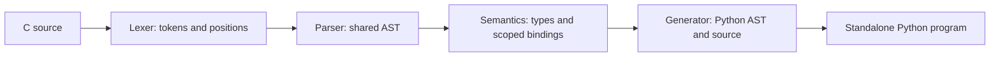

# A classroom walkthrough

Use this small program to follow one value through all four compiler phases:

```c
int main(void) {
    int x = 5;
    return x + 2;
}
```

Save it as `lesson.c`, then inspect and generate it:

```sh
cminus lesson.c --dump-tokens --dump-ast --dump-symbols --verbose-passes -o lesson.py
python -I -S lesson.py
```

The program prints nothing and exits with status 7. On POSIX shells, `echo $?`
shows that status immediately after execution. Inspection output uses stderr,
leaving generated source and program output separate.



## Observe the phases

The lexer recognizes `int`, identifiers, decimal literals, punctuation, and EOF.
For example, the declaration begins with `2:5 KEYWORD 'int'` and
`2:9 IDENTIFIER 'x'`. Comments disappear from the token stream, while positions
still refer to the original source.

The parser groups those tokens into a `Program` containing a `FunctionDecl`.
Its body holds a `VarDecl` initialized by `IntLiteral(5)` and a `Return` whose
value is `BinaryOp('+', Identifier('x'), IntLiteral(2))`. Operator precedence is
encoded in tree structure, rather than recovered during generation.

Semantic analysis creates the global function scope and a child scope for
`main`. It binds `x` and the later identifier reference to the same declaration,
then annotates the addition as `int`. In this program the builtin `printf` has
binding ID 0, `main` has ID 1, and `x` has ID 2. Change `x` to `missing` in the
return statement to see a positioned undeclared-variable diagnostic.

The generator produces:

```python
# Generated by C-Minus; standalone Python 3.10+.
import sys as _cminus_sys

def main():
    x__cm2 = int(5)
    return int(x__cm2 + 2)
    return 0
if __name__ == '__main__':
    raise SystemExit(main())
```

The renamed identifier preserves the resolved binding. The final `return 0`
implements C's implicit return from `main` when execution reaches its end;
the earlier explicit return takes precedence. Python source is built through
Python's AST library and syntax-checked before it is returned.

## Explore behavior that needs translation rules

Run `examples/factorial.c` to observe typed parameters, recursion, and `for`
lowering. Inspect `tests/gcc_cases/bindings.c` to see why shadowed C variables
need different Python names. Compare `tests/gcc_cases/arithmetic.c` with Python's
`//` and `%` to study negative integer division and remainder.

`tests/gcc_cases/short_circuit.c` prints markers from helper calls, making skipped
operands visible. `tests/gcc_cases/loop_conditions.c` shows that condition calls
must be evaluated on every test. `tests/gcc_cases/formatting.c` demonstrates
formatted output, the return value of `printf`, and a nonzero program exit.

```sh
cminus-check examples/factorial.c --cc gcc
cminus-check tests/gcc_cases/formatting.c --cc gcc
```

The checker first runs the compiler's `--version`, compiles the original source
in C11 mode, and executes both programs with separate timeouts. It compares
stdout and stderr as bytes and checks process exit status. This provides evidence
for the supported cases; it does not establish compatibility with arbitrary C.
